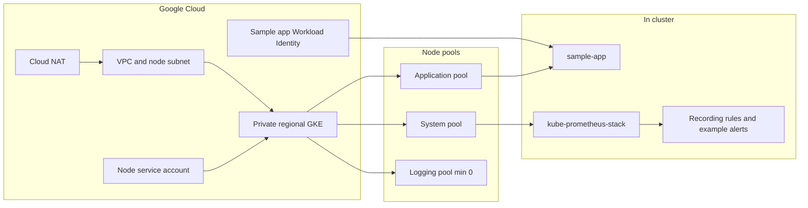

# GKE Production Blueprint

An example private regional GKE platform: VPC and Cloud NAT, three autoscaled node pools, Workload Identity, a sample app, Prometheus and Grafana config, and CI that does not need cloud credentials.

[](#roadmap)
[](LICENSE)

**Maria Christine Espero** — Site Reliability Engineer. The Terraform, manifests, dashboards, and workflow in this repo are the example. GitHub Actions checks formatting and schema only. It does not log in to Google Cloud, and it does not create a cluster.

New to this repo? Follow [docs/runbook.md](docs/runbook.md). It installs the tools, then [deploys](docs/runbook-deploy.md) and covers [day-2 operations, alerts, and teardown](docs/runbook-operations.md). Steps that create billable resources are marked.

---

## Overview

The example shows how a small platform team can lay out GKE:

- A VPC-native regional cluster with private nodes, a private control plane endpoint, and Cloud NAT for egress.
- A system pool for add-ons, an application pool for the sample workload, and a logging pool reserved for a collector that is not in this repo yet.
- Workload Identity and a node service account limited to `roles/container.defaultNodeServiceAccount`.
- podinfo as a reference app, with requests and limits, probes, an HPA, a PodDisruptionBudget, and default-deny NetworkPolicies.
- kube-prometheus-stack values, a Grafana dashboard, Prometheus recording rules, and an SLO write-up whose numbers are labeled as examples.

This is an independent portfolio project. It is separate from any employer environment. Sizes, CIDRs, and SLO targets in the files are placeholders. See [docs/slo.md](docs/slo.md).

## Architecture

The diagram matches the modules and manifests in the repo. The logging pool exists in Terraform and scales from zero because no collector is scheduled onto it.



| Piece | What the example does |
| --- | --- |
| Network | Custom VPC, private Google access, secondary ranges, flow logs, Cloud NAT. Nodes have no public IP. |
| Cluster | Regional, private nodes, private endpoint, Dataplane V2, Workload Identity, Shielded Nodes, release channel `REGULAR`. |
| System pool | No taint, so GKE add-ons and kube-prometheus-stack can schedule. Cluster Autoscaler total min 1, max 3. |
| Application pool | Taint `workload=app:NoSchedule`. The sample app tolerates it and requires `node-pool=application`. |
| Logging pool | Taint `workload=logging:NoSchedule`, total min 0. Nothing in the repo schedules here yet. |
| Sample app | podinfo `6.15.0`, HPA 2–6 on CPU, PDB, probes, restricted pod security, default-deny NetworkPolicy. |
| Observability | Helm values for chart `92.10.1`, Grafana dashboard JSON, `PrometheusRule` for the example SLO. Managed Prometheus is left off so there is one metrics path. |
| CI | `terraform fmt`, `terraform validate`, tflint, yamllint, kubeconform. No plan and no apply. |

GKE still creates a default node pool for a moment during cluster create, then Terraform removes it. On a regional cluster that initial count is per zone. Details are in [terraform/README.md](terraform/README.md).

## What this demonstrates

### Networking

`terraform/modules/network` builds the VPC, subnet, and NAT. The cluster uses those ranges and Dataplane V2, which enforces NetworkPolicy without the Calico add-on. `manifests/sample-app/networkpolicy.yaml` denies traffic in the sample namespace except DNS, the Workload Identity metadata address, HTTP from the same namespace, and scrapes from `monitoring`.

This example does not create a bastion, VPN, or IAP tunnel. With the private endpoint enabled, `kubectl` needs a path you provide yourself.

### Autoscaling

Each node pool sets Cluster Autoscaler totals (`total_min_node_count` / `total_max_node_count`). The sample Deployment requests CPU so the Horizontal Pod Autoscaler can read utilization. GKE's metrics-server is the signal. The HPA bounds, 2 to 6 replicas at 70% CPU, are example numbers.

### Observability

`monitoring/kube-prometheus-stack-values.yaml` is written for chart 92.10.1. Control plane jobs that GKE does not expose (etcd, scheduler, controller-manager, kube-proxy) are disabled. Prometheus selects ServiceMonitors and PrometheusRules in every namespace, which is how the sample app and the SLO rules are picked up.

The Grafana dashboard is `monitoring/dashboards/sample-app.json`. Kustomize turns it into a ConfigMap labeled `grafana_dashboard=1`, which the chart's sidecar loads. Panels are titled as examples.

Workload logs go to Cloud Logging through the cluster `logging_config` (`SYSTEM_COMPONENTS` and `WORKLOADS`). A collector on the logging pool is still future work.

### CI/CD

`.github/workflows/ci.yml` runs on pull requests and on pushes to `main`:

1. `terraform fmt -check`
2. `terraform init -backend=false` and `terraform validate`
3. tflint with the Google ruleset
4. yamllint
5. `kustomize build` piped to kubeconform, including the Prometheus Operator CRDs

`terraform plan` needs a state bucket and Google credentials, so it stays a local step. Apply is a local step too. There is no deploy environment in this repository.

### Security

- Private nodes and a private control plane endpoint. The authorized network in the example is `203.0.113.10/32` from RFC 5737 documentation space. Replace it before any real apply.
- Node service account: `roles/container.defaultNodeServiceAccount` only, not the Compute Engine default account.
- Sample app Google service account: no project roles. podinfo does not call Google APIs. The Kubernetes service account is allowed to impersonate it, and its API token is not mounted.
- Pod security: `restricted` on the sample namespace, non-root, dropped capabilities, read-only root filesystem, seccomp.
- `*.tfvars`, kubeconfigs, and key files are gitignored. No credentials are committed.

Policy-as-code and image signature checks are not in the repo. The sample image is pinned to a tag, not a digest.

### SLOs

[docs/slo.md](docs/slo.md) defines an availability SLI and a latency SLI for the sample app, with example targets of 99.9% and 300ms p99. The recording rules and alerts in `monitoring/prometheusrule.yaml` use those same example numbers and are labeled `example: "true"`. They are not measurements.

## Repository structure

```text
.
├── .github/workflows/ci.yml
├── docs/runbook.md               # beginner guide: tools, project, billing
├── docs/runbook-deploy.md        # state, apply, private endpoint, Helm, checks
├── docs/runbook-operations.md    # scale, alerts, teardown
├── docs/slo.md
├── manifests/sample-app/          # deployment, HPA, PDB, NetworkPolicy, ServiceMonitor
├── monitoring/
│   ├── kube-prometheus-stack-values.yaml
│   ├── prometheusrule.yaml
│   └── dashboards/sample-app.json
├── terraform/
│   ├── modules/network
│   ├── modules/gke
│   ├── modules/iam
│   ├── terraform.tfvars.example
│   └── README.md                  # remote state and apply notes
├── LICENSE
└── README.md
```

## Getting started

If you have not applied this example before, use [docs/runbook.md](docs/runbook.md) and continue through [docs/runbook-deploy.md](docs/runbook-deploy.md). The short form below is the same sequence without the per-command explanation. It **costs money** at `terraform apply`.

### Prerequisites

For CI, nothing beyond Git is required; the workflow installs its own tools.

To plan or apply locally:

- A Google Cloud project and permission to create networks, GKE clusters, and IAM
- [Google Cloud SDK](https://cloud.google.com/sdk/docs/install)
- [Terraform](https://developer.hashicorp.com/terraform/install) 1.10 or later
- [kubectl](https://kubernetes.io/docs/tasks/tools/) and [Helm](https://helm.sh/docs/intro/install/) 3
- A GCS bucket for state, created outside this module

### Check the example

```bash
git clone <repository-url>
cd gke-production-blueprint
```

The same commands CI runs are listed in `.github/workflows/ci.yml`. A local `terraform validate` looks like this:

```bash
terraform fmt -check -recursive
terraform -chdir=terraform init -backend=false -input=false
terraform -chdir=terraform validate
```

### Apply, when you mean to

Remote state, the placeholder project id, and the private endpoint are covered in [terraform/README.md](terraform/README.md). Short version:

```bash
cd terraform
cp terraform.tfvars.example terraform.tfvars
# set project_id and replace master_authorized_cidrs

terraform init \
  -backend-config="bucket=STATE_BUCKET" \
  -backend-config="prefix=gke-production-blueprint"
terraform apply
```

Then install the example workload. The Helm chart is not vendored. Chart `92.10.1` matches the values file. The Grafana admin password is generated by the chart; read it from the release secret rather than putting one in git.

```bash
gcloud container clusters get-credentials CLUSTER --region REGION --project PROJECT_ID

helm repo add prometheus-community https://prometheus-community.github.io/helm-charts
helm repo update
helm upgrade --install kube-prometheus-stack prometheus-community/kube-prometheus-stack \
  --namespace monitoring \
  --create-namespace \
  --version 92.10.1 \
  --values monitoring/kube-prometheus-stack-values.yaml

kubectl apply -k monitoring
kubectl apply -k manifests/sample-app
```

`get-credentials` needs a route to the private control plane. This repo does not create that route. CPU and memory requests in the manifests and Helm values are examples; the system pool's `e2-standard-2` is an example too, and a real install should resize it once the monitoring pods are scheduled.

If you change `project_id` or `name_prefix`, point the sample ServiceAccount annotation at `terraform output -raw sample_app_gsa_email`.

## Roadmap

| Milestone | Status | In this repo |
| --- | --- | --- |
| Foundations | Implemented | VPC, private regional cluster, three node pools, Workload Identity, least-privilege service accounts. |
| CI guardrails | Implemented | fmt, validate, tflint, yamllint, kubeconform. Plan and apply stay local because they need credentials. |
| Networking | Implemented | Terraform network, Dataplane V2, sample-app NetworkPolicies. No bastion. |
| Autoscaling | Implemented | Cluster Autoscaler totals and an HPA. Bounds are examples. |
| Observability | Implemented as config | Helm values, dashboard, alert and recording rules. CI does not install them. |
| Security | Implemented in part | Private cluster, IAM, Workload Identity, pod security, NetworkPolicy. No policy-as-code or image provenance. |
| SLOs | Example | [docs/slo.md](docs/slo.md) and matching rules. Targets are examples, not measurements. |
| Later | Not started | A log collector for the logging pool, Terraform for a bastion (the runbook creates a manual VM instead), policy-as-code, image digest pinning, and a capacity note written from a real apply. |

## Author

**Maria Christine Espero** is a Site Reliability Engineer based in Taguig, Philippines, with about five years in software engineering and the recent years spent on Kubernetes platforms, especially GKE.

| Role | Organization | Focus |
| --- | --- | --- |
| Site Reliability Engineer (Mar 2026 – present) | Safeway Philtech | AKS and Google Cloud, Kafka, GitHub Deployments, Grafana, MySQL |
| Software Engineer, Advanced App Engineering Analyst | Accenture Philippines | GKE support on Google Cloud |
| SRE Specialist | Opswerks | Hubble, Grafana, Spark, Airflow, Amazon EKS, Splunk, Kubernetes |

Certifications:

- Google Associate Cloud Engineer
- Kubernetes Administrator
- Professional Cloud DevOps Engineer
- Apache Airflow

She also works with Terraform and OpenTofu, GitHub Actions, Prometheus, Google Cloud Logging and Cloud Monitoring, Python, Bash, and PowerShell. Outside platform work she designs branding and illustration.

This repository is the portfolio home for the blueprint above. Profile details stay on the GitHub account that owns the repo, so they remain current if the username changes.

## License

Released under the [MIT License](LICENSE).
