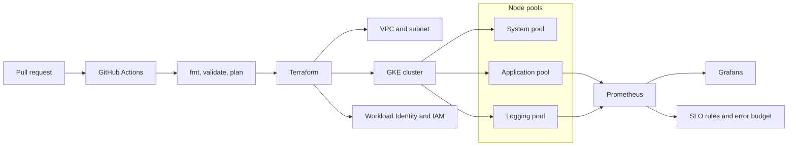

# GKE Production Blueprint

A portfolio blueprint for a production Google Kubernetes Engine platform: networking, autoscaling, Prometheus and Grafana, CI/CD, security, and SLOs.

[](#roadmap)
[](LICENSE)

**Maria Christine Espero** — Site Reliability Engineer. This repository is the public design for that blueprint. Terraform, Kubernetes manifests, dashboards, and GitHub Actions workflows are still on the [roadmap](#roadmap).

---

## Overview

The blueprint describes how a small platform team can run GKE with production guardrails:

- A VPC-native cluster with separate node pools for system pods, application workloads, and log shipping.
- Scheduling controls (taints, tolerations, and node affinity) so noisy logging pods stay on their own pool.
- Pull-request checks for Terraform formatting, validation, and plan output.
- Metrics in Prometheus, dashboards in Grafana, and a written SLO for each reference workload once one exists.

This is an independent portfolio project. It reflects how the author builds and supports Kubernetes platforms, and it is separate from any employer environment.

## Target architecture

The diagram is the intended design. The modules that create it are the first roadmap milestone.



| Piece | Intended role |
| --- | --- |
| System node pool | Cluster add-ons. Tainted so application pods are not scheduled here. |
| Application node pool | Tenant and reference workloads, isolated by namespace, RBAC, and network policy. |
| Logging node pool | High-throughput log shipping, kept off the system and application pools with taints, tolerations, and node affinity. |
| GitHub Actions | On each pull request: `terraform fmt -check`, `terraform validate`, and `terraform plan`. Apply stays on a protected branch. |
| Prometheus and Grafana | Cluster and workload metrics, dashboards, and the recording rules behind each SLO. |

A capacity note with machine types, disk, and regional choices will live in `docs/` when those values are chosen. Resource numbers belong in that note.

## What this blueprint will demonstrate

Each area below is in scope for the portfolio. The artifacts are listed as roadmap items until they land in the repository.

### Networking

A VPC-native GKE cluster, a dedicated subnet, controlled egress, and Kubernetes network policies for traffic between namespaces. Logging and application pools stay on separate scheduling domains so east-west traffic and node placement are explicit.

### Autoscaling

Horizontal Pod Autoscaler on reference workloads, and Cluster Autoscaler on the application and logging pools. Minimum size on the system pool stays high enough for add-ons. Requests and limits are required on every workload the blueprint ships.

### Observability

Prometheus scrapes cluster and workload metrics. Grafana holds the operational dashboards. The same signals feed SLO recording rules. Google Cloud Logging can sit beside this stack later; the first dashboards to add are Prometheus and Grafana, which matches the monitoring path this project is built to show.

### CI/CD

The pull-request workflow will run:

1. `terraform fmt -check`
2. `terraform validate`
3. `terraform plan` against a documented remote state layout

Apply will be a reviewed action on the default branch. The workflow files arrive with the CI/CD milestone.

### Security

Workload Identity for Google API access, namespace RBAC with least privilege, and admission checks so pods set a non-root security context. Secrets and `*.tfvars` stay out of git (see `.gitignore`). Policy-as-code and image provenance checks are later milestones.

### SLOs

Every reference workload will ship a short SLO document: the user journey, the SLI query, the target, and the error-budget policy. Targets will be written when a service exists to measure.

## Repository structure

What is in the repository now:

```text
.
├── LICENSE
├── README.md
└── .gitignore
```

Layout planned for later pull requests:

```text
.
├── terraform/             # VPC, GKE, node pools, IAM, Workload Identity
├── manifests/             # reference workloads, network policies, HPA
├── monitoring/            # Prometheus, Grafana, SLO recording rules
├── docs/                  # capacity notes, SLO write-ups, runbooks
└── .github/workflows/     # fmt, validate, and plan
```

Those paths will be added with the milestone that fills them.

## Getting started

### Prerequisites

You will need these when the Terraform milestone is merged:

- A Google Cloud project, with permission to create networks, GKE clusters, and IAM bindings
- [Google Cloud SDK](https://cloud.google.com/sdk/docs/install)
- [kubectl](https://kubernetes.io/docs/tasks/tools/)
- [Terraform](https://developer.hashicorp.com/terraform/install) 1.6 or later
- Git

### Clone

```bash
git clone <repository-url>
cd gke-production-blueprint
```

Cluster creation starts once the Terraform milestone is merged. Until then, read the [roadmap](#roadmap). The first implementation pull request should add a Terraform root module and a GitHub Actions workflow that rejects a pull request when `fmt` or `validate` fails.

Keep credentials out of the tree. Use Application Default Credentials locally, and keep project-specific values in an untracked `terraform.tfvars`.

## Roadmap

| Milestone | Outcome |
| --- | --- |
| 1. Foundations | Terraform for the VPC, a VPC-native GKE cluster, the three node pools, and Workload Identity. |
| 2. Guardrails in CI | Pull-request workflow for `terraform fmt`, `terraform validate`, and `terraform plan`. |
| 3. Networking | Network policies and the egress path documented next to the Terraform. |
| 4. Autoscaling | Cluster Autoscaler settings and an HPA on a small reference workload. |
| 5. Observability | Prometheus scrape config and Grafana dashboards under `monitoring/`. |
| 6. Security | RBAC, pod security defaults, and a documented secret-handling approach. |
| 7. SLOs | One SLO document and recording rules for the reference workload. The target is set with that workload. |
| Later | Policy-as-code, image provenance, Cloud Logging integration, and a capacity note once sizes are real. |

## Author

**Maria Christine Espero** is a Site Reliability Engineer based in Taguig, Philippines, with about five years in software engineering and the recent years spent on Kubernetes platforms, especially GKE.

| Role | Organization | Focus |
| --- | --- | --- |
| Site Reliability Engineer (Mar 2026 – present) | Safeway Philtech | AKS and Google Cloud, Kafka, GitHub Deployments, Grafana, MySQL |
| Software Engineer, Advanced App Engineering Analyst | Accenture Philippines | GKE support on Google Cloud |
| SRE Specialist | Opswerks | Hubble, Grafana, Spark, Airflow, Amazon EKS, Splunk, Kubernetes |

Certifications:

- Google Associate Cloud Engineer
- Kubernetes Administrator
- Professional Cloud DevOps Engineer
- Apache Airflow

She also works with Terraform and OpenTofu, GitHub Actions, Prometheus, Google Cloud Logging and Cloud Monitoring, Python, Bash, and PowerShell. Outside platform work she designs branding and illustration.

This repository is the portfolio home for the blueprint above. Profile details stay on the GitHub account that owns the repo, so they remain current if the username changes.

## License

Released under the [MIT License](LICENSE).
